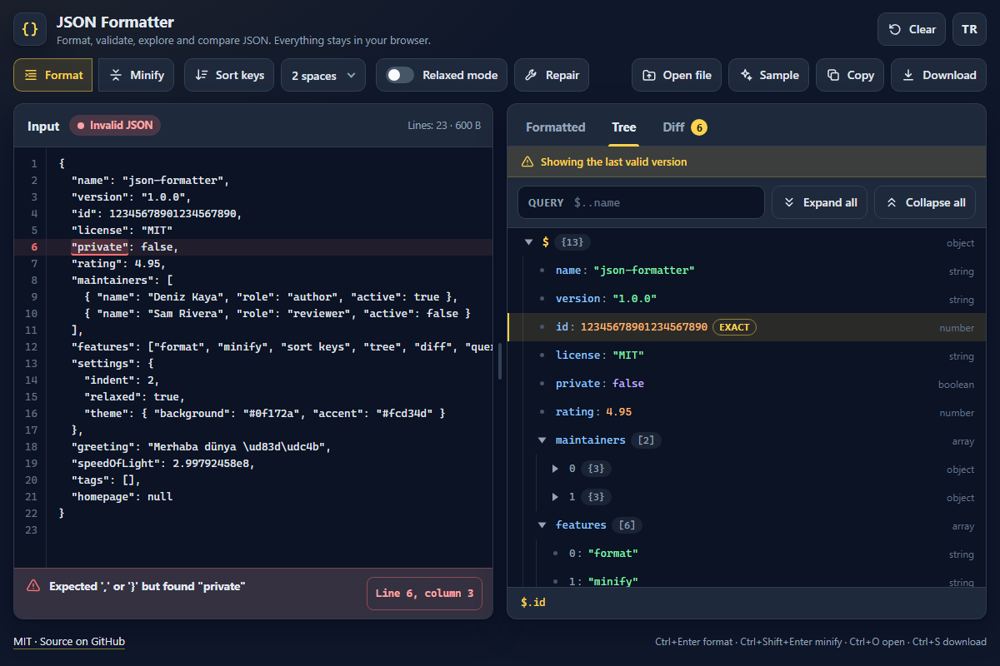

# JSON Formatter - format, validate, repair, explore and diff JSON in your browser

[](#tests)
[](LICENSE)

**▶ Open the app: https://celaldrg.github.io/json-formatter/**



A small, dependency-free JSON tool with its own hand-written parser. It points at the exact line
and column of a mistake, keeps big numbers exactly as written and never sends your data anywhere.

## Features

- **Format and minify** with 2 spaces, 4 spaces or tabs; **sort keys** at every level.
- **Exact errors:** every syntax error has a line, a column and a plain sentence (English or
  Turkish). The editor shows line numbers and marks the spot; one tap jumps the caret there.
- **Relaxed mode** accepts comments, trailing commas, single quotes and unquoted keys. **Repair**
  rewrites them into strict JSON and lists each fix with its position.
- **No rounding:** a 20-digit id or a long decimal is printed as written, not as a JavaScript
  number would round it; the tree marks such values as *exact*.
- **Tree view:** collapsible, with types and child counts. Tap a row to copy its path
  (`$.maintainers[0].name`). A query box filters with a small JSONPath subset:
  `$..name`, `$.items[*].id`, `$.list[-1]`.
- **Diff:** paste a second document to see what was added, removed or changed, path by path.
- **Files:** open a file or drop it on the page, load a sample, copy the output or download it
  (`name.formatted.json` / `name.min.json`).
- **Built for big files:** the tree only draws the rows on screen, and typing in a very large
  input is parsed once you pause. Draggable splitter on wide screens, English and Turkish,
  settings remembered in your browser.
- **Depth limit:** nesting can go 1000 levels deep. A deeper document gets the error *Nesting is
  deeper than 1000 levels*, even though `JSON.parse` would accept it.

## How to use

Paste JSON into the input (or press **Sample**). The output updates as you type; while the input
is broken, the last valid version stays visible with a notice.

| Action | Keyboard | Touch / mouse |
| --- | --- | --- |
| Format / minify | `Ctrl+Enter` / `Ctrl+Shift+Enter` (`⌘` on macOS) | **Format** / **Minify** |
| Open / download a file | `Ctrl+O` / `Ctrl+S` | **Open file**, drag and drop / **Download** |
| Jump to an error | Tab to the *Line …, column …* button, `Enter` | Tap the button |
| Switch output tabs | `←` `→` `Home` `End` on the tab list | Tap a tab |
| Move in the tree | `↑` `↓` `PageUp` `PageDown` `Home` `End` | Scroll |
| Open / close a node | `→` / `←` | Tap the ▸ triangle |
| Copy a node's path | `Enter` or `Space` | Tap the row |
| Resize the panes | Focus the splitter, `←` `→` `Home` `End` | Drag the splitter (double-click resets) |

**TR / EN** in the header switches the language; **Clear** empties the input, the query and the
second document.

## Run locally

There is no build step. Serve the folder with any static server, for example:

```sh
npx serve .
```

Then open the printed `http://` address. ES modules do not load from `file://`, so opening
`index.html` directly from disk does not work. Add `?demo` to the address for the fixed state
used in the screenshot.

## Tests

```sh
node --test
```

Node 22 or newer, no dependencies. The suites cover the parser (valid documents, every error code
with its line and column, the nesting limit), relaxed parsing and repair, formatting (indents,
minify, sorted keys, highlighting, exact big numbers), tree rows and paths, the query language,
the diff, the app state without the DOM (modes, stale output, the `?demo` state), both
languages (same keys, a sentence for every error), the storage wrapper in private mode, the view
helpers, the toast messages and the keyboard mapping. 500 seeded random strict documents and 500
relaxed ones are checked against `JSON.parse` and `JSON.stringify`.

## Project structure

```
index.html            page markup and icon sprite
style.css             dark theme, mobile-first layout
src/
  lexer.js parser.js ast.js errors.js text.js   hand-written parser with exact positions
  repair.js           relaxed mode fixes
  formatter.js        pretty print, minify, sorted keys, highlight segments
  tree.js path.js query.js diff.js              tree rows, paths, queries, diff
  workspace.js        app state, no DOM
  i18n.js samples.js  strings (EN/TR) and sample documents
  storage.js          localStorage wrapped in try/catch
  view-utils.js shortcuts.js                    pure helpers for the views
  main.js toolbar.js input-pane.js output-pane.js *-view.js splitter.js file-io.js dom.js   UI
test/                 node --test suites
docs/screenshot.png
```

## License

[MIT](LICENSE) © 2026 Celalettin Durgaç

## Türkçe

**▶ Uygulamayı aç: https://celaldrg.github.io/json-formatter/**

Bağımlılığı olmayan, kendi elle yazılmış ayrıştırıcısıyla çalışan küçük bir JSON aracı. Hatanın
satırını ve sütununu tam gösterir, büyük sayıları yazıldığı gibi korur, verinizi hiçbir yere
göndermez.

### Özellikler

- 2 boşluk, 4 boşluk ya da sekmeyle **biçimlendirme** ve **küçültme**; her düzeyde **anahtar
  sıralama**.
- **Tam hata konumu:** her sözdizimi hatası satır, sütun ve açık bir cümleyle (Türkçe ya da
  İngilizce) gelir. Düzenleyici satır numaralarını gösterir ve hatanın yerini işaretler; tek
  dokunuş imleci oraya götürür.
- **Esnek mod** yorumları, sondaki virgülleri, tek tırnakları ve tırnaksız anahtarları kabul
  eder. **Onar** bunları katı JSON'a çevirir ve her düzeltmeyi konumuyla listeler.
- **Yuvarlama yok:** 20 haneli bir kimlik ya da uzun bir ondalık, bir JavaScript sayısının
  yuvarlayacağı gibi değil, yazıldığı gibi basılır; ağaç bu değerleri *aynen* olarak işaretler.
- **Ağaç görünümü:** açılıp kapanır, türleri ve alt öğe sayılarını gösterir. Bir satıra dokununca
  yolu kopyalanır (`$.maintainers[0].name`). Sorgu kutusu küçük bir JSONPath alt kümesiyle süzer:
  `$..name`, `$.items[*].id`, `$.list[-1]`.
- **Fark:** ikinci bir belge yapıştırın; neyin eklendiğini, silindiğini ya da değiştiğini yol yol
  görün.
- **Dosyalar:** dosya açın ya da sayfaya bırakın, örnek yükleyin, çıktıyı kopyalayın ya da indirin
  (`ad.formatted.json` / `ad.min.json`).
- **Büyük dosyalara hazır:** ağaç yalnızca ekranda görünen satırları çizer; çok büyük bir girdi,
  yazmaya ara verdiğinizde ayrıştırılır. Geniş ekranlarda sürüklenebilir ayırıcı, İngilizce ve
  Türkçe arayüz; ayarlar tarayıcınızda hatırlanır.
- **Derinlik sınırı:** iç içe yapı 1000 düzeye kadar iner. Daha derin bir belge, `JSON.parse`
  kabul etse bile *İç içe yapı 1000 düzeyden derin* hatası alır.

### Nasıl kullanılır

JSON'u girdiye yapıştırın (ya da **Örnek**'e basın). Çıktı siz yazdıkça güncellenir; girdi
bozukken son geçerli sürüm bir uyarıyla birlikte görünür kalır.

| Eylem | Klavye | Dokunmatik / fare |
| --- | --- | --- |
| Biçimlendir / küçült | `Ctrl+Enter` / `Ctrl+Shift+Enter` (macOS'ta `⌘`) | **Biçimlendir** / **Küçült** |
| Dosya aç / indir | `Ctrl+O` / `Ctrl+S` | **Dosya aç**, sürükle-bırak / **İndir** |
| Hataya git | `Tab` ile *Satır …, sütun …* düğmesine gelin, `Enter` | Düğmeye dokunun |
| Çıktı sekmesini değiştir | Sekme listesinde `←` `→` `Home` `End` | Sekmeye dokunun |
| Ağaçta gezin | `↑` `↓` `PageUp` `PageDown` `Home` `End` | Kaydırın |
| Düğümü aç / kapat | `→` / `←` | ▸ üçgenine dokunun |
| Düğümün yolunu kopyala | `Enter` ya da `Space` | Satıra dokunun |
| Bölmeleri boyutlandır | Ayırıcıya odaklanın, `←` `→` `Home` `End` | Ayırıcıyı sürükleyin (çift tıklama sıfırlar) |

Başlıktaki **TR / EN** dili değiştirir; **Temizle** girdiyi, sorguyu ve ikinci belgeyi boşaltır.

### Yerelde çalıştırma

Derleme adımı yok. Klasörü herhangi bir statik sunucuyla sunun, örneğin:

```sh
npx serve .
```

Sonra ekrana yazılan `http://` adresini açın. ES modülleri `file://` üzerinden yüklenmez; bu
yüzden `index.html` dosyasını doğrudan diskten açmak çalışmaz. Ekran görüntüsündeki sabit durumu
görmek için adresin sonuna `?demo` ekleyin.

### Testler

```sh
node --test
```

Node 22 ya da üstü, bağımlılık yok. Testler ayrıştırıcıyı (geçerli belgeler, satırı ve sütunuyla
her hata kodu, iç içe yapı sınırı), esnek ayrıştırmayı ve onarımı, biçimlendirmeyi (girintiler,
küçültme, sıralı anahtarlar, sözdizimi renklendirmesi, aynen korunan büyük sayılar), ağaç
satırlarını ve yolları, sorgu dilini, farkı, DOM olmadan uygulama durumunu (modlar, son geçerli
çıktı, `?demo` durumu), iki dili (aynı anahtarlar, her hata için bir cümle), gizli modda depolama
sarmalayıcısını, görünüm yardımcılarını, kısa bildirimleri ve klavye eşlemesini kapsar. Tohumlu
500 rastgele katı ve 500 esnek belge `JSON.parse` ve `JSON.stringify` ile karşılaştırılır.

### Lisans

[MIT](LICENSE) © 2026 Celalettin Durgaç
